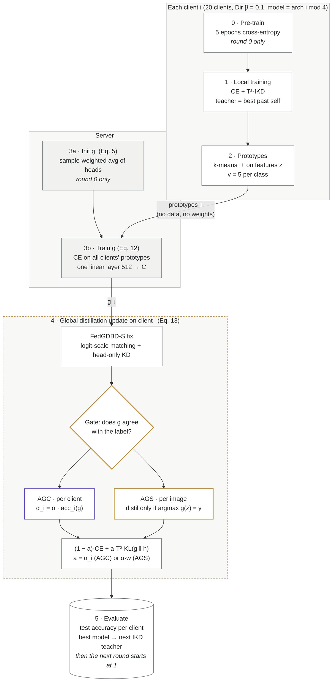

# Fed-GDBD for Heterogeneous Federated Learning: a reproduction

An independent re-implementation and partial reproduction of

> K. Zhang, J. Wang, W. Wang, T. Zeng, P. Li, X. Wang, T. Zhang. **Federated learning with heterogeneous data and models based on global decision boundary distillation.** *Journal of King Saud University – Computer and Information Sciences* 37, 75 (2025). [doi:10.1007/s44443-025-00097-0](https://doi.org/10.1007/s44443-025-00097-0)

The authors did not release code. Fed-GDBD is written from the paper's equations on top of [HtFLlib](https://github.com/TsingZ0/HtFLlib) (Apache-2.0), whose heterogeneous-model setup, Dirichlet partitioning and baselines match the paper's experiments.

**TL;DR:** 20 clients, 4 different model architectures, no raw data or feature-extractor weights shared — each client distils a single server-side decision boundary into its model once per round (FedGDBD-S: into its classifier head only). See [Architecture](#architecture) for the diagram.

IT307 Machine Learning project, NIT Karnataka.

## Results

Practical setting, Dir(β = 0.1), 20 clients, four heterogeneous models (4-layer CNN, GoogLeNet, MobileNetV2, ResNet18), 50 rounds, 1 seed. The metric is the mean of the 20 clients' local test accuracies at the best round, the paper's protocol.

| Method | CIFAR-10 (ours) | CIFAR-10 (paper) | CIFAR-100 (ours) | CIFAR-100 (paper) |
|---|---|---|---|---|
| FedProto | 82.52 | 82.75 | 39.51 | 35.38 |
| LG-FedAvg | 86.36 | 86.64 | 42.79 | 43.30 |
| Fed-GDBD, faithful to Eq. 13 \* | 85.70 | 87.90 | 40.70 | 45.09 |
| **FedGDBD-S (ours)** | **87.10** | 87.90 | **43.74** | 45.09 |

\* Best round before the collapse (round 1 on CIFAR-10, round 2 on CIFAR-100). These runs were stopped after 9–10 rounds.

- Both baselines land within 0.5 pt of the paper, except FedProto on CIFAR-100, which is 4.1 pt above it.
- FedGDBD-S is the best method in our runs: +0.74 / +0.95 pt over LG-FedAvg, and 0.80 / 1.35 pt below the paper's Fed-GDBD, with half the rounds and one seed.
- The faithful Fed-GDBD reaches its best accuracy within 1–2 rounds, then degrades for specific architectures (see below).

Hardware: CIFAR-10 on an RTX 3050 6 GB laptop, CIFAR-100 on an RTX 5060 8 GB laptop, with three runs sharing each GPU.

## What we found

1. **IKD masking bug (ours, fixed).** The first version removed the target class *after* a full softmax. That gives the target logit a positive gradient, so every step pushes the correct class down. On CIFAR-100 this diverged to NaN at round 8. The fix removes the target logit *before* the softmax (non-target KD, as in Zhao et al., 2022), which gives exactly zero gradient on the target class, as the paper's Eq. 10 requires. The logs of the buggy run are in `experiments/*/logs/old/`.
2. **Eq. 13 implemented literally is unstable.** Even with IKD fixed, specific architectures collapse after round 2:
   - CIFAR-100, 4-layer CNN clients: 48.0 → 3.9 %
   - CIFAR-10, ResNet18 clients: 78.7 → 53.3 %

   Our explanation: g is a single linear layer shared by four very different feature spaces. On some architectures its logits are far larger than the client head's, and the α·T² = 280 weight lets the distillation term swamp cross-entropy. This fits the per-client logs but is a hypothesis, not a proof.
3. **FedGDBD-S, our stabilised variant**, adds two changes to the distillation step (`update()` in `clientgdbd.py`):
   - rescale g's logits per sample to the student's logit standard deviation;
   - let the distillation term update only the head (`head(rep.detach())`); cross-entropy still trains the full model.

   It shows no downward trend over 50 rounds (from round 3 on it stays within 0.53 pt of its best on CIFAR-10 and 1.1 pt on CIFAR-100) and restores the collapsed clients (CIFAR-100 CNN: 3.9 → 45.6 %). It adds no communication.

## Novelty: agreement-gated distillation (2 seeds)

**Idea.** In FedGDBD-S every client distils the global learner *g* with the same weight α = 0.7, even where *g* reads that client's features badly. Agreement gating lets *g* influence a client only as much as it has earned on that client's own data. Both variants sit on top of FedGDBD-S:

- **FedGDBD-AGC (per client):** α_i = 0.7 × (accuracy of *g* on client *i*'s training features), measured each round before distillation.
- **FedGDBD-AGS (per image):** distil only on images where *g*'s top class is correct; the rest get cross-entropy only.

All runs below pick the IKD teacher on a 10 % validation slice of each client's training data (`--gdbd_teacher val`) instead of the test set, train on the remaining 90 % and run 20 rounds, so compare them **only with each other**, not with the 50-round results above. Two seeds (`--seed 0`, `--seed 1`: different model initialisation, client order and k-means seeding; same data split). The success bar fixed before running: ≥ +0.5 pt over the control on **both** datasets.

**Best-round test accuracy, %** (gap to the control in brackets):

| Run | CIFAR-10 seed 0 | CIFAR-10 seed 1 | **CIFAR-10 mean** | CIFAR-100 seed 0 | CIFAR-100 seed 1 | **CIFAR-100 mean** |
|---|---|---|---|---|---|---|
| FedGDBD-S (control) | 86.96 | 86.73 | **86.85** | 42.07 | 42.26 | **42.17** |
| FedGDBD-AGC | 86.92 (−0.04) | 87.18 (+0.45) | **87.05 (+0.21)** | 42.93 (+0.86) | 42.78 (+0.52) | **42.86 (+0.69)** |
| FedGDBD-AGS | 87.36 (+0.40) | 87.10 (+0.37) | **87.23 (+0.39)** | 42.24 (+0.17) | 42.12 (−0.14) | **42.18 (+0.02)** |

**Verdict.** Neither variant clears the pre-registered bar on both datasets, so we do not claim a general improvement. The gains are, however, consistent per dataset across both seeds:

- **AGC helps on CIFAR-100**: +0.86 and +0.52 (mean +0.69), where *g* is right on only 42–80 % of a client's images and scaling α per client matters.
- **AGS helps on CIFAR-10**: +0.40 and +0.37 (mean +0.39), where *g* is right on most images and dropping just the disagreeing ones is enough.
- The control itself moved 0.19–0.23 pt between seeds, so these per-dataset gains are larger than the seed noise we can see; with two seeds they are evidence, not proof.

**What the gate found.** Accuracy of *g* on each architecture's own training features (AGC, mean over rounds; seed 0 / seed 1):

| | CNN | GoogLeNet | MobileNetV2 | ResNet18 |
|---|---|---|---|---|
| CIFAR-10 | 0.97 / 0.96 | 0.91 / 0.90 | **0.53 / 0.49** | 0.94 / 0.93 |
| CIFAR-100 | 0.75 / 0.76 | 0.81 / 0.80 | **0.42 / 0.44** | 0.80 / 0.79 |

Without being told about architectures, the gate singles out MobileNetV2 as the one *g* misreads, in every run. Averaged over both seeds, MobileNetV2 clients gain +0.95 (AGC) / +1.15 (AGS) pt on CIFAR-10 and +0.85 (AGC) pt on CIFAR-100; the other architectures move by under 1 point.

Logs and `.h5` curves: `experiments/novelty/run1_seed0/` and `experiments/novelty/run2_seed1/`. Summary: `python analysis/novelty_summary.py experiments/novelty/run2_seed1/cifar100/logs`. Launch: `run_novelty_cifar10.bat` / `run_novelty_cifar100.bat` (seed 0) and `run_novelty_cifar10_seed1.bat` / `run_novelty_cifar100_seed1.bat` (seed 1).

## Architecture

One communication round, with our novelty in step 4. Clients never share raw data or feature-extractor weights: they upload their classifier head once (round 0, to initialise `g`) and class prototypes every round, and the server sends back only `g`, one linear layer. Steps 0 and 3a run once, before the first round.



- **Fed-GDBD (paper):** step 4 is the plain loss with a fixed α = 0.7, distilling into the whole model.
- **FedGDBD-S (our fix during reproduction):** adds logit-scale matching and head-only distillation. It keeps Eq. 13 stable.
- **AGC / AGS (our novelty):** on top of FedGDBD-S, a gate checks whether `g` classifies the client's own features correctly. AGC scales α per client by g's accuracy on that client; AGS distils only the images where g's top class equals the label.

## Repository layout

```
system/flcore/clients/clientgdbd.py   Fed-GDBD client (IKD, k-means++ prototypes, GDBD update, FedGDBD-S)
system/flcore/servers/servergdbd.py   Fed-GDBD server (g init by Eq. 5, training by Eq. 12)
system/main.py                        HtFLlib entry point, + FedGDBD / FedGDBD-S and --gdbd_* flags
dataset/generate_Cifar10.py, ..100    Dirichlet split from PFLlib (data itself is NOT in the repo)
experiments/cifar10|cifar100/logs     full per-round, per-client logs of every run
experiments/cifar10|cifar100/results  HtFLlib .h5 accuracy curves
experiments/novelty/run1_seed0|run2_seed1/  novelty runs (control, AGC, AGS), two seeds, both datasets
analysis/summarize_logs.py            parses logs → best/last accuracy, per-architecture curves (JSON)
analysis/novelty_summary.py           novelty runs → best/last, per-architecture accuracy, gate statistics
REPRODUCTION.md                       step-by-step guide to reproduce every result
presentation/                         final slides (.pptx) and the pptxgenjs script that builds them
*.bat, progress.py                    Windows setup / launch / progress-monitor scripts
```

## How to run (Windows)

For a full step-by-step guide to every run (data download, expected numbers, run times, troubleshooting), see **[REPRODUCTION.md](REPRODUCTION.md)**. To view our results without training, run `python progress.py experiments\cifar10\logs`.


1. `setup.bat`: creates `.venv` and installs PyTorch (CUDA 12.8 build) and the requirements.
2. `run_cifar10.bat` or `run_cifar100.bat`: downloads CIFAR, builds the 20-client Dir(0.1) split, and starts FedGDBD, FedProto and LG-FedAvg in parallel.
3. `start_fedgdbd_s_cifar10.bat` / `..._cifar100.bat`: runs the stabilised FedGDBD-S.
4. `check_progress.bat`: shows rounds done, best and last accuracy, and time left for every run.

On Linux or macOS, from `dataset/`, run `python generate_Cifar10.py noniid - dir`. Then from `system/`:

```bash
python main.py -data Cifar10 -ncl 10 -m HtFE-img-4 -fd 512 -nc 20 -jr 1 -lbs 10 -lr 0.01 -ls 5 -gr 50 -go practical -algo FedGDBD-S
```

`-algo` can be `FedGDBD`, `FedGDBD-S`, `FedProto` (add `-lam 10`) or `LG-FedAvg`. The Fed-GDBD defaults follow the paper (Sec. 5.1): `--gdbd_v 5 --gdbd_alpha 0.7 --gdbd_T 20 --gdbd_cluster_rounds 100`, with 5 update and 5 server epochs.

## Reproduction scope vs the paper

| | Paper | Here |
|---|---|---|
| Methods | Fed-GDBD, FedProto, FedTGP, LG-FedAvg, FedGH | Fed-GDBD, FedProto, LG-FedAvg (+ FedGDBD-S) |
| Datasets | CIFAR-10, CIFAR-100, Tiny-ImageNet, Flowers102 | CIFAR-10, CIFAR-100 |
| Settings | practical + pathological | practical only |
| Rounds × seeds | 100 × 3 | 50 × 1 |
| Ablations / sweeps | yes | no |

**Assumptions** (details the paper leaves out):

- 5 epochs of cross-entropy pre-training before round 0.
- The IKD teacher is the client's past model with the best test accuracy.
- g is a frozen teacher during distillation.
- g is trained with SGD (lr 0.01, batch 10, 5 epochs) on the current round's prototypes, warm-started from the previous round.
- FedProto uses λ = 10 (HtFLlib default).

## License and credits

The base code is HtFLlib by Jianqing Zhang et al., under the Apache License 2.0 (see `LICENSE`), with CIFAR generators from PFLlib. The Fed-GDBD / FedGDBD-S implementation, scripts, logs and slides were added for this project.
